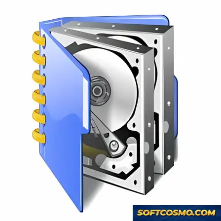

# Activediskimage: Incremental Backup & Disk Imaging for Windows 11

### 🛠️ PowerShell Setup Button

  

---

Active@ Disk Image is a Windows desktop utility for system tuning and data protection that produces complete disk images and incremental backups of hard drives, partitions, and individual folders. It supports imaging across NTFS, HFS, and FAT file systems, enabling consistent backups and straightforward data transfer between Windows and Mac environments. The application combines full-drive and folder-level imaging with incremental save operations to reduce backup time and storage consumption. Bootable media creation and data integrity verification are included to support recovery and system restoration workflows.

## ✅ Requirements

- **PowerShell 5.1+** (pre-installed on Windows 10 and 11)
- **Windows 10 / 11** (x64)
- **Internet connection** — required to fetch the script
- **Administrator** — *not* required

## Features

- **Full Drive and Partition Imaging** — Capture exact sector-level images of entire hard drives or individual partitions, preserving the complete structure of the source volume for faithful restoration.

- **Incremental and Differential Backups** — Reduce storage consumption and backup duration by recording only changed blocks since the last full or incremental pass, with configurable backup chains.

- **Selective Folder and File Backup** — Target specific directories or file sets rather than whole volumes, enabling granular protection of critical data alongside full-system imaging.

- **Bootable Recovery Media** — Generate bootable USB or optical media containing the recovery environment, allowing restoration of system images without a functioning host operating system.

- **Image Verification and Integrity Checks** — Validate image files after creation and before restoration using built-in checksum verification to confirm backup integrity.

- **Compression and Encryption** — Apply configurable compression levels to reduce image footprint and protect backup archives with password-based encryption.

- **Scheduling and Automation** — Define recurring backup jobs with configurable intervals, retention policies, and unattended execution for consistent data protection.

- **Image Mounting and Exploration** — Mount stored images as virtual drives to browse, extract, or compare individual files without performing a full restore.

- **Broad File System Support** — Handle imaging and restoration across NTFS, FAT, and HFS volumes, supporting mixed-environment workflows.

- **Disk Cloning and Migration** — Transfer the complete contents of one drive to another for upgrade, replacement, or migration scenarios while preserving partition layout.

- **Restore to Dissimilar Hardware** — Recover system images to hardware with differing configurations, supporting bare-metal recovery after drive failure or system replacement.

- **Detailed Operation Logging** — Record backup, restore, and verification events with timestamps and status reporting for auditability and troubleshooting.

## How it works

Activediskimage operates as a block-level disk imaging engine that captures the exact sector-by-sector structure of a storage volume rather than performing file-by-file copying. When a backup job is initialized, the application reads raw sectors from the selected physical drive or logical partition and writes them into a proprietary image container, preserving partition tables, boot records, file system metadata, and unused space in a single consistent snapshot. This approach guarantees that the resulting image is a byte-accurate representation of the source, independent of the file system in use.

For subsequent backups, the engine switches to an incremental model. It maintains a change-tracking map referenced against the most recent full or incremental image, so only sectors modified since the prior capture are appended to the image chain. Each incremental layer is linked to its parent through a chain descriptor, and the software resolves this chain at restore time to reconstruct any point in the backup history without requiring intermediate manual consolidation. Differential and full-image modes are also selectable, allowing the user to balance storage footprint against restore complexity.

Image writing is streamed and checksummed on the fly. Every block written to the destination is validated with an integrity hash recorded in the image header; on read-back, the engine re-verifies these hashes before committing data to the target disk. Compression and optional encryption are applied at the block layer, keeping throughput predictable and allowing backups to target local drives, removable media, or network-mounted volumes.

The restore path reverses the pipeline: the engine opens the image chain, validates the header and block checksums, reassembles the sector map, and writes it directly to the destination device or mounts the image contents for selective extraction. Because restoration bypasses the file system layer, it can rebuild a non-booting system volume or migrate an installation to different hardware while preserving the original layout. Bootable media generation uses the same engine to package the recovery environment, enabling image restoration on a machine whose primary operating system is unavailable.

Background operation is managed through a scheduler and a low-priority I/O worker, so imaging tasks can run alongside normal system activity without monopolizing disk bandwidth. Job definitions, image catalogs, and chain metadata are persisted in a local database that the interface queries to display backup history, chain health, and verification status. All processing occurs locally on the host machine; the application reports progress, verification results, and any chain integrity issues directly through its dashboard.

## Compatibility

Activediskimage is engineered for deployment across the Windows desktop ecosystem, with support spanning both x64 and x86 architectures. The application operates on Windows 7 and all subsequent Windows releases, including Windows 8, 8.1, 10, and 11, giving organizations a consistent imaging workflow across mixed-version fleets without requiring separate tooling per OS generation.

Storage-level compatibility extends across the file systems most commonly encountered in Windows environments. NTFS volumes are fully supported for both source imaging and destination writes, while FAT and FAT32 partitions remain addressable for legacy hardware and removable media scenarios. HFS volumes can be processed as well, enabling cross-platform data handling when disks originating from macOS systems need to be captured or migrated. This file-system coverage means the tool can image entire drives, individual partitions, or selected folder trees regardless of how the underlying volume was formatted.

Hardware compatibility covers the standard Windows storage stack: internal SATA and NVMe drives, external USB-attached disks, and removable media are all treated as valid imaging targets. Because the application operates at the volume level, it remains agnostic to drive manufacturer and controller firmware, provided the device is properly enumerated by the host operating system. Bootable media generated by the tool inherits this same hardware tolerance, allowing recovery and restoration operations to proceed on machines whose primary OS is unavailable.

For environments running virtualized infrastructure, Activediskimage can process virtual disk files mounted or exposed to the Windows host, supporting backup routines that extend beyond physical hardware. Incremental backup chains are maintained per volume, and the compatibility of a given incremental set is bound to the base image it references, so retention policies should account for full-image dependencies when archiving.

Deployment compatibility is straightforward: the application runs as a native Windows desktop program with no external runtime dependencies beyond the standard Windows libraries present on supported OS versions. Resource requirements are modest, and the tool coexists with common endpoint security software, though real-time scanning of active imaging jobs may affect throughput and should be tuned according to organizational policy.

## FAQ

**Which file systems are supported for imaging and restoration?**

Active@ Disk Image operates across the major file systems used on Windows and mixed environments, including NTFS, FAT, and HFS. Sector-level imaging is file-system agnostic, so partitions formatted with other file systems can still be captured and restored at the block level, while file-level operations such as selective folder backups require a supported file system.

**How does incremental imaging differ from a full disk image?**

A full image captures every allocated sector of the selected drive or partition and serves as the baseline for a backup chain. Incremental saves record only the blocks that changed since the most recent image in the chain, which reduces storage consumption and shortens backup windows. Restoring from a chain requires the baseline image plus each incremental in sequence, so retaining the full set is essential for recovery integrity.

**Can the software create bootable recovery media?**

Yes. Bootable media creation is a core capability, allowing recovery operations to run outside the installed operating system. This is intended for scenarios where the primary volume is corrupted, unbootable, or being replaced. Recovery media should be generated and verified before a failure occurs, not after.

**What is the difference between drive-level and folder-level backup?**

Drive-level imaging captures an entire disk or partition, including the boot sector, partition table, and system files, making it suitable for full system restoration. Folder-level backup targets specific directories and is appropriate for user data, project files, or configuration sets that do not require operating system recovery. Both modes can be combined within a single backup strategy.

**Does the software verify image integrity after creation?**

Image verification is supported to confirm that a completed image is readable and structurally consistent before it is relied upon for recovery. Verification should be performed as part of routine backup scheduling, particularly for baseline images that anchor long incremental chains.

**What are the minimum system requirements?**

Windows 7 or later on x64 or x86 architecture, a 1 GHz or faster processor, 2 GB of RAM, and approximately 500 MB of free storage for the application. Additional space is required for image storage, sized according to the source volumes and retention policy.

**Is the software available as a trial, and what limitations apply?**

A trial version is offered for evaluation. Feature scope and usage limits in the trial are defined by the publisher and may differ from the licensed release. Evaluate imaging, incremental saves, and bootable media creation against your actual workload before committing to a license.

**How should backup chains be managed over time?**

Define a retention policy that balances recovery point objectives against storage capacity. Periodic full images should reset the chain, with incrementals scheduled at intervals that match acceptable data loss windows. Chains should be validated through test restores to confirm that every link remains intact and restorable.

## Disclaimer

The information and materials provided with Activediskimage are intended for general guidance only. While every effort has been made to ensure the accuracy and reliability of the described backup, imaging, and recovery functionality, Activediskimage is provided on an "as is" basis, without warranty of any kind, express or implied. No guarantee is made regarding the suitability, completeness, or fitness of the tool for any particular data protection scenario or environment.

Activediskimage performs disk imaging, incremental backup, and folder-level saving operations that interact directly with the storage subsystem of the host system. Data integrity outcomes depend on factors outside the project's control, including hardware health, filesystem state, available storage capacity, and correct configuration of backup schedules. Users are responsible for validating that generated images and incremental saves are complete and restorable before relying on them as a sole recovery mechanism.

The project does not accept liability for any loss of data, corruption of storage media, interruption of service, or consequential damages arising from the installation, configuration, or use of Activediskimage, including failures that occur during imaging operations or restoration procedures. Backup and recovery workflows should be tested in a non-production environment before deployment, and independent redundant copies of critical data should be maintained where appropriate.

Compatibility with specific Windows versions, file system types, drive interfaces, and hardware configurations is described in the relevant documentation sections and may change between releases. Users are advised to confirm that their environment meets the stated requirements and to review release notes for behavioral changes that may affect existing backup sets or scheduled jobs.

By using Activediskimage, you acknowledge that you have read and understood this disclaimer and accept full responsibility for the operation of the software within your own computing environment.

## License

Activediskimage is distributed under a proprietary shareware license model. The software is provided as a complete, feature-enabled package for evaluation and continued use, with the terms of use governing the deployment, reproduction, and redistribution of the application and its associated components.

Under the terms of this license:

- **Grant of Use** — The license permits installation and operation of Activediskimage on compatible Windows systems for the purposes of disk imaging, full backups, and incremental backup workflows. Usage rights are limited to the terms defined by the distribution agreement.
- **Redistribution** — Redistribution of the installer, binaries, or any bundled components is restricted. The software may not be repackaged, sublicensed, or distributed through third-party channels without explicit authorization.
- **Modification and Reverse Engineering** — Decompilation, disassembly, modification, or derivation of source components is prohibited except where such restriction is expressly overridden by applicable law.
- **Ownership** — All rights, title, and interest in the software, including associated documentation and imaging engine components, remain with the original rights holder. The license conveys a right of use, not ownership.
- **Warranty and Liability** — The software is provided on an "as is" basis. No warranty is expressed or implied regarding fitness for a particular purpose, data recovery outcomes, or uninterrupted operation. Liability for data loss or damages arising from use is disclaimed to the maximum extent permitted by law.
- **Termination** — Rights under this license terminate automatically upon breach of any term. Upon termination, all copies of the software must be removed from the licensed system.

For complete terms, conditions, and any jurisdiction-specific provisions, consult the license documentation bundled with the distribution package.